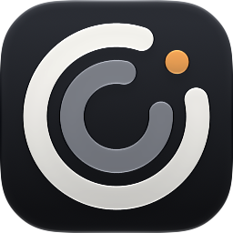

<!-- markdownlint-disable-next-line MD033 MD041 -->


# claude-multipass

Switch the Claude Desktop app on macOS between several claude.ai accounts without typing an email code each time, and keep every account's Claude Code sessions listed in the Code tab after a switch.

It is for one Mac with more than one account (personal, work, a second plan): when one hits its 5-hour or weekly limit, switch to the other and carry on. The Code tab lists the sessions of every saved account after a switch; resuming a session under a different account than the one that started it has not been tested yet.

```sh
claude-multipass save personal   # once: the account Desktop is signed in as
claude-multipass add work        # once: relaunches at the sign-in screen
claude-multipass save work       # once: after signing in with the email code
claude-multipass switch personal # every day: no email code, both accounts' sessions listed
claude-multipass                 # or pick one in fzf
```

## Install

```sh
brew install jrmatherly/tap/claude-multipass
```

Needs `jq` (installed with it); `fzf` for the picker; `openssl`, `curl` and the Command Line Tools (`xcode-select --install`, for their `/usr/bin/python3`) for the opt-in `usage` command, which exits 1 naming them when they are missing. The CLI login moves through `/usr/bin/security`, the tool Claude Code uses for its own item; the first `switch` may ask once to let `security` use an item: click Always Allow, which persists. Or clone the repo and put `bin/claude-multipass` on your PATH.

## How it works

A Desktop login is three keys of `~/Library/Application Support/Claude/config.json` plus the cookie files, encrypted by the app with a key in this Mac's login Keychain. `save` copies them as opaque bytes into a named profile; `switch` quits Desktop, re-saves the login you are leaving, swaps the saved one in, merges every account's Code-tab session list into every other account's, and relaunches. Nothing is decrypted for that, and nothing switches on its own. The Claude Code CLI's login (a login-Keychain item plus `oauthAccount` in `~/.claude.json`) is saved with the profile when the terminal is signed in as the same account, and moves with it on `switch`; the token only ever travels between two items of the same Keychain. The menu bar app only polls `list --json` (no Keychain) and, when you turn usage on, `usage --json` at most every 5 minutes.

Claude Code transcripts live in `~/.claude/projects`, shared by every account, so a session started under one account can be continued under another. Chats, Projects and memory on claude.ai stay with their account.

[docs/claude-multipass.md](docs/claude-multipass.md) has the full command table, what carries over, the folders, the safety rails and the recovery steps. `claude-multipass --help` prints the command reference. [docs/research.md](docs/research.md) is the research the tool was built from, including the alternatives and the open questions.

## Commands

| Command | What it does |
| --- | --- |
| `list`, `show <name>`, `current` | What is saved and which account is signed in. `list --json` prints one object for scripts and the menu bar app |
| `save`, `add`, `switch`, `remove`, `rename` | Manage saved logins; `save`, `add` and `switch` quit and relaunch Desktop |
| `sync` | Only the session-list merge (Desktop must be quit, or `--force`) |
| `usage [name]` | 5-hour (or `Ultra`), weekly and per-model weekly (Fable) usage per saved account. Opt-in: it decrypts the saved token with the app's Keychain key and reads Anthropic's OAuth usage endpoint outside the app. It also reads the profile endpoint for the plan name at most once a day per account, or an hour after a failed request while no name is cached. Third-party coverage says Anthropic's terms discourage both. Read-only, runs only when asked |
| `pick` | The fzf picker (also a bare invocation on a terminal) |
| `doctor` | Check the setup: config, tools, store modes, profile tokens, which profiles hold no CLI login, `claude` missing from PATH, a set `ANTHROPIC_API_KEY` or `CLAUDE_CODE_OAUTH_TOKEN`. Without a working `jq` it skips the config and token checks and says so. Exits 1 on any `fail:` line |

`--no-relaunch` leaves Desktop quit; `--force` overrides the refusals named in `--help`. Run `save`, `switch` and `add` from Terminal or the menu bar app, not from a terminal inside Desktop (the Code tab): the tool refuses there, since quitting Desktop would end that shell. On a `config.json` that `jq` cannot read as one object, `save`, `switch` and `add` exit 1 before Desktop quits, and `--force` does not lift it. Quit any running `claude` terminal session before a switch: it is assumed to keep its old token and write it back on its next refresh (`switch` warns when one runs). A profile saved before the CLI login existed switches Desktop only until the account is signed in with `claude auth login` and saved again (the next `switch` away from it captures the login too).

## Cautions

- Never use Desktop's own **Log out** to change accounts; it may revoke the saved token on the server. Use `add` or `switch`.
- Sign in with the email code, not Google, so the browser hand-back lands in the right window.
- Profiles are per Mac: the app's Keychain key encrypts them. Save each account once on every Mac.
- A third-party gateway that configures Desktop in its own mode (a `Claude-3p` data folder beside `Claude`) is not seen by the tool; a switch with it active can relaunch the gateway's instance. Close it first. Uninstall steps are in `docs/claude-multipass.md`.
- Whether to run several accounts, and `usage`, is your call under Anthropic's terms. This tool keeps switching manual and never rotates accounts by itself.

## Raycast

`raycast/` holds three script commands (current account, usage, switch). Copy them to a folder you own, because Homebrew's `share` path is a symlink into a versioned folder that changes on upgrade and the macOS picker hides `/opt`:

```sh
mkdir -p ~/.config/claude-multipass/raycast && cp -R "$(brew --prefix)/share/claude-multipass/raycast/." ~/.config/claude-multipass/raycast
```

Then in Raycast, **Settings, Script Commands, Add Script Directory**, press Cmd+Shift+G in the picker and enter `~/.config/claude-multipass/raycast`.

## Menu bar app

**Claude Multipass** is a menu bar app over the same tool. The strip shows a ring gauge, with an inner ring for a per-model limit, and the signed-in saved account (`not saved` or `signed out` otherwise). A left click opens a popover with the signed-in account first, then the other saved accounts under "Switch to"; clicking one expands an inline confirm, and Switch runs `claude-multipass switch` (Desktop quits and relaunches). A right click gives Refresh, Settings and Quit. Install:

```sh
brew install --cask jrmatherly/tap/claude-multipass-app
```

Settings, About checks for a newer version at launch and once a day, by reading one public file. A toggle there turns the check off, and Check now runs one on demand. When a newer version exists, About shows a badge and the change log for every version you skipped, and the popover footer and the right-click menu each get a line that opens it. Update and relaunch runs `brew` on a cask install and replaces the app in place on a DMG install. Nothing installs without that click.

The cask depends on the `claude-multipass` formula and the app needs 0.3.0 or newer; it says so in the popover when the tool is missing or older. A DMG install works without Homebrew, because the app carries the tool inside it and uses that copy when no Homebrew tool is found. On macOS 14, and on any Mac without `/usr/bin/jq`, it also needs `jq`: without a working one every command but `--version`, `--help` and `doctor` exits 1 with a message naming `jq`, before Desktop quits. Turning usage on needs the Command Line Tools on any version, and without them `usage` exits 1 naming them. To run that copy from a terminal, link it with `mkdir -p ~/.local/bin && ln -s "/Applications/Claude Multipass.app/Contents/Resources/claude-multipass" ~/.local/bin/claude-multipass`, and put `~/.local/bin` on your PATH if it isn't. The Raycast commands add only `/opt/homebrew/bin` and `/usr/local/bin` to Raycast's PATH, so for them make the link in `/usr/local/bin`, with `sudo`. The first launch of a downloaded build needs the network once, for Gatekeeper to check the notarization ticket. The first switch asks once whether Claude Multipass may control Claude (the Automation prompt): allow it, or every switch waits 8 s for Desktop to be force-quit instead of asked to quit. A switch that moves a CLI login may also raise a Keychain prompt for `security` once; click Always Allow.

Usage is off by default. It covers the rings' fill and the percentage in the strip, and the plan name and the 5-hour, weekly and Fable bars in the popover. An Ultra account whose 5-hour window is missing or idle with no reset has no 5-hour bar. The popover header shows the plan name and when the weekly limit resets, and only the 5-hour bar names its own reset. Turning it on in Settings has the same caution as the `usage` command: the app runs `claude-multipass usage --json` on a timer, at least 5 minutes apart, which decrypts the saved tokens through this Mac's Keychain (one prompt the first time; click Always Allow) and reads Anthropic's usage endpoint outside the app, plus the profile endpoint for the plan name, at most once a day per account (hourly while that fails with no name cached). Turn it off and the polling stops.

## Development

`pnpm check` is the gate: `bash -n`, ShellCheck, Prettier, the fixture self-check (`test/claude-multipass.sh`, which stubs the app, Keychain and network and never touches the real Desktop folder), the Claude Code hook self-checks, the menu bar app's `swift test` (which needs Xcode, not only the Command Line Tools, for the SwiftUI macro plugin), and the app icon's compile (`scripts/compile-icon.sh`, which also needs Xcode, for `actool`). CI runs it on macOS for every pull request and push to `main`.

The mechanism follows [SnlperStripes/claude-account-switcher](https://github.com/SnlperStripes/claude-account-switcher) (Desktop login swap and session-list sync) and the token scheme shared by [realiti4/claude-swap](https://github.com/realiti4/claude-swap) and [XueshiQiao/CCSwitcher](https://github.com/XueshiQiao/CCSwitcher). MIT licence.
